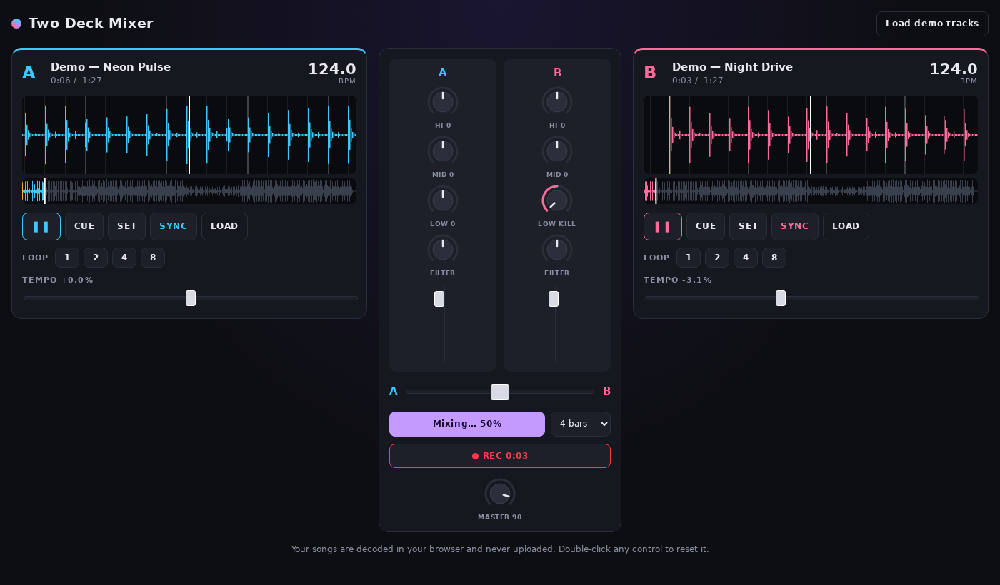

# Two Deck Mixer

A DJ mixer that runs in the browser. Load any two songs, beatmatch them and build a transition with EQ, filters, loops and a crossfader, then record the mix.



**[Live demo →](https://claregartz.github.io/dj-mixer/)**

## Features

- **Two decks.** Drag and drop MP3, WAV, FLAC, M4A or OGG files. Each deck has a scrolling waveform with a beat grid plus a full-track overview you can click to seek.
- **Automatic BPM detection** for every loaded track.
- **Sync.** One click matches tempo *and* lines up the beats with the other deck.
- **Tempo control** of ±16%.
- **3-band EQ** (high/mid/low with full kill) and a **filter knob** that works as a low-pass when turned left and a high-pass when turned right.
- **Beat loops** of 1, 2, 4 or 8 beats, snapped to the beat grid.
- **Cue points.**
- **Equal-power crossfader**, so the volume doesn't dip in the middle of a fade.
- **Auto Mix.** Syncs the incoming track, starts it with the bass cut, rides the crossfader over 4–32 bars and swaps the basslines halfway through (a standard house/techno transition).
- **Record** the master output and download the mix.
- **Built-in demo tracks** generated in code at load time, so there are no audio files or licensing concerns.

## Privacy and copyright

Songs you load are decoded **in your browser** and are never uploaded anywhere. This repo contains no copyrighted music. The demo tracks are synthesized in code (`src/audio/demoTracks.ts`).

## How it works

Everything uses the [Web Audio API](https://developer.mozilla.org/en-US/docs/Web/API/Web_Audio_API) and there is no backend.

```
Deck: BufferSource → Low shelf → Mid peak → High shelf → Low-pass → High-pass → Volume ┐
                                                                                       ├→ Crossfader → Master → Speakers
Deck: (same chain) ────────────────────────────────────────────────────────────────────┘                      └→ MediaRecorder
```

| File | Purpose |
| --- | --- |
| `src/audio/Deck.ts` | Playback, playhead tracking, EQ/filter, loops, beat sync |
| `src/audio/engine.ts` | Mixer, crossfader, master bus and recording |
| `src/audio/demoTracks.ts` | Synthesizes demo house tracks with an `OfflineAudioContext` |
| `src/components/Waveform.tsx` | Canvas waveform rendering with beat grid |
| `src/App.tsx` | UI state and the Auto Mix automation |

BPM detection uses [`web-audio-beat-detector`](https://github.com/chrisguttandin/web-audio-beat-detector).

## Run locally

```bash
npm install
npm run dev
```

## Deploy

Push to `main` on GitHub, then under **Settings → Pages** set **Source** to **GitHub Actions**. The workflow in `.github/workflows/deploy.yml` builds and publishes the site.

## Tech

React 19 · TypeScript · Vite · Web Audio API · Canvas
